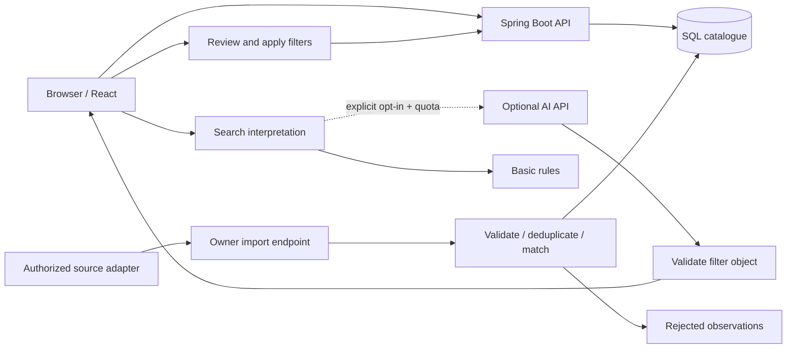

# Architecture and decisions

## One deployable application

React is compiled with esbuild and served by Spring Boot on the same origin. The browser uses JSON endpoints. Spring JDBC accesses a relational database managed by Flyway. The default is an embedded H2 file; the container template uses PostgreSQL. There is no need for a queue, distributed cache or separate frontend service at this catalogue size.

## Identity and condition are separate

`configuration` represents a disclosed lens variant. Its deterministic key includes category, normalized brand, model code, mount, sensor coverage, focal range, maximum aperture, autofocus and stabilization. Conservative case/whitespace normalization is applied; there is no fuzzy merge. Human-readable model names do not override differing manufacturer codes. If required matching fields are missing, the configuration is scoped to the seller/listing and cannot produce a cross-seller matching verdict.

`offer` represents a physical copy at one seller, identified by `(retailer_id, external_key)`. An adapter must not recycle that external key for a different physical item. Each copy has independent defects, original description, grade, accessories, terms, availability and latest observation time. An `ABSENT` optical defect is a seller assertion, not an inspection by this application. `UNKNOWN` is distinct from `ABSENT`.

`observation` records price/availability snapshots, their configuration ID, source batch and a payload fingerprint. It is not a full archival copy of every condition disclosure: the latest disclosure is retained on the offer. History is scoped to the physical listing and current variant; it does not combine different sellers or silently merge changed variants.

Money is integer paise in INR. Unknown shipping remains null; the app does not imply a known delivered total or use conditional card discounts to rank offers. Default sorting is listed price with sold-out offers last and shipping visibly separate.

## Imports, correctness and recovery

* One transactional database row lock serializes imports. This intentionally favors understandable race safety over throughput. All instances using the same database share the lock.
* A caller-generated batch ID is idempotent only with an identical ordered payload. Replaying it returns the original counts. Different data under the same ID is rejected.
* A duplicate physical listing inside one batch rejects the whole batch before writes.
* Invalid rows are quarantined with a reason; valid siblings can commit. Unexpected database failures roll back the transaction. Corrected data uses a new batch ID.
* Identical repeated observations under new batch IDs do not duplicate history at the same timestamp. Different data at the same timestamp is quarantined instead of being arbitrarily selected.
* Older observations can add historical evidence but cannot overwrite a newer offer. A failed validation does not refresh freshness.
* The public-page collector produces a bounded source snapshot. Failed sources retain old observations and timestamps. A successful source snapshot can deactivate disappeared listings without asserting that they sold or deleting history. The owner batch API remains incremental and never hides absent rows.
* Demo seeding is transactional and skips completed batches. A completed seed is never refreshed by application restart.

## Search and matching tradeoffs

SQL filtering is sufficient for this pilot. It uses parameterized queries, literal wildcard escaping, bounded page sizes and stable ID tie-breaking. A future larger catalogue may need full-text indexes and keyset pagination. Current OFFSET pagination can shift during concurrent writes; no stable multi-page snapshot is promised.

The optional AI is a filter interpreter, not the source of offers. It receives only the explicitly opted-in search text, and its output passes an allowlist/type/range check. Its requests have a timeout, no retries and a transactional UTC daily reservation cap. Invalid output and provider failures fall back visibly to basic rules. Rule-based search does not understand arbitrary use-case requests such as “best wildlife lens”; unsupported requirements may be ignored, which is disclosed before the user applies anything.

Model matching currently trusts adapter-provided specifications. A future reviewed manufacturer catalogue, provenance per field, alias proposals and human review would improve real-world matching. The current code does not claim manufacturer verification, compatibility certification, AI extraction accuracy, or fuzzy matching accuracy.

## Privacy and operating boundaries

The application stores only daily aggregate event/category counts, retained for 90 days, plus ordinary product data. No user/account table exists. Saved IDs and a usage preference live in browser storage. Automatic counts respect DNT/GPC and opt-out; explicitly submitted feedback remains available. Counts are event volume, not unique users or conversion attribution.

An in-memory, per-connection-address fixed-window limit bounds POST requests and is reset each minute. It neither persists addresses nor trusts caller-supplied forwarding headers. It is not a distributed abuse-prevention system. A reverse proxy may make visitors share one address; production requires trusted proxy configuration and shared edge limits. Declared request sizes are bounded in the app; the deployment edge must also reject oversized/chunked bodies. Model provider costs are bounded by attempts/tokens in this adapter, not a guaranteed monetary ceiling across all external services.

## Adding another category

Keep sellers, physical listings, money, observations, ingestion and comparison infrastructure shared. Extract lens attributes into a typed category module before adding phone/tablet/laptop fields. Each category needs its own matching contract and disclosure vocabulary; do not squeeze battery health into lens condition or treat a generic attribute map as a substitute for validation. The `category` column is an expansion point, not a claim that other categories are already implemented.

## Deployment progression

1. Real public-page observations with H2; bounded twelve-source coverage and explicit freshness.
2. Broader reviewed adapters or dealer feeds, PostgreSQL integration tests and manufacturer mappings.
3. One cloud instance/container with backups, TLS and monitoring.
4. Kubernetes only when there is a reason to demonstrate deployment recovery or multiple workers. Template probes and resource limits are included, but no cloud deployment or load benchmark is claimed.

## Real-source pipeline

`tools/refresh_sources.py` is an explicit network job, independent of request serving. It reads selected public pages from twelve reviewed hosts. Fujifilm X India, Foto Centre India, Just Canon, Cashify, Dacby, Camera Club, RK Deals, ShopAtSC, Flipkart, Srishti Digilife and Pooja Electronics use product JSON-LD; Amazon uses reviewed ASINs from a public search page, excluding accessory results, crossed-out MRP and conditional coupons. Marketplace observations are platform listings, not a claim about a stable individual merchant or physical unit.

The collector retains each failed source’s previous rows without changing `observedAt`. A source failure is visible in `/api/sources`. Source scope is selected products, not the whole retailer. Successful runs write a temporary file then atomically replace the snapshot. The backend checks the local file every minute, hashes its contents and imports changed snapshots transactionally. Replaying the same file does not create history. Any rejected row rolls back the entire snapshot import. Missing offers are deactivated only inside the snapshot’s managed source set; history remains accessible. A backend reload failure preserves the previous catalogue.

V2 adds `listing_type` and `active`. New/used filters are explicit, independent of matching lens specifications. The loader rejects demo observations. Each source offer retains an HTTPS purchase/source URL. No web fetch occurs in response to arbitrary visitor input. This is on-demand collection with scheduled **local-file reload**, not scheduled web scraping or a provider SLA.

A shared retailer registry restricts real imports to reviewed HTTPS retailer destinations. Removed sources are deactivated without erasing observation history. Inactive offers are inaccessible through search, detail, history and comparison. Mount and purchase-type filters separate Sony E / Canon EF-S / Canon RF / Nikon Z / Fujifilm X and new / used / refurbished offers.

V3 adds nullable product score/count/count-type columns with an all-or-none database constraint. Import validation restricts scores to 1–5 and counts to positive bounded integers. Rating updates share the import transaction and timestamp ordering of prices. The optional rating field is omitted when null during fingerprint serialization to preserve legacy import replay hashes. Ratings use the offer source and observation time as provenance. Catalogue queries exclude sold-out rows by default, with an explicit opt-in; rows and history remain stored.

The collector resolves manufacturer separately from mount. A mount-specific URL selects one offer; multi-mount family text alone cannot identify a variant. Explicit backorders use the existing availability varchar column and are excluded by the in-stock query. Fotocentre's exact variant stock HTML overrides generic structured stock; related-product stock is never used. No database migration was needed for this expansion.
